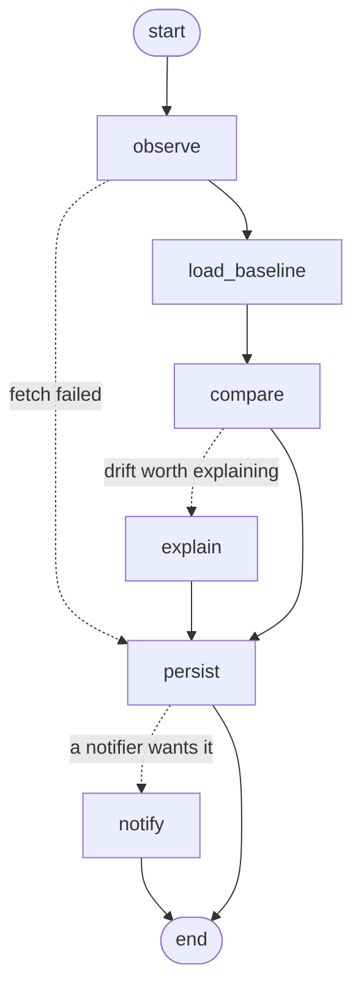

# tiltmeter

**Catch API schema drift before your AI agents do.**


Agents call third-party APIs all day. When a vendor renames a field, starts returning `null`
or turns a number into a string, typed code crashes loudly. An agent doesn't: it reads the
new response, fills the gap with a guess, or retries until the budget is gone.

tiltmeter watches the APIs you depend on. It learns the shape of their JSON responses from
real traffic, flags the changes that matter, explains them with Claude, and answers one
question for your agents over MCP: *has this API drifted?*

- **No schema needed.** It learns from responses, so it works with any JSON API, with or
  without an OpenAPI spec.
- **Only what matters.** Changes are classified as breaking, warning or info. A removed
  field next to a similar new one is flagged as a probable rename.
- **Built for agents.** An MCP server gives Claude Code, Cursor or any MCP client
  `has_drifted`, `get_schema` and friends.
- **Fits CI.** Exit codes fail the build on breaking drift. Slack and webhook alerts take
  one line of config.
- **Local and private.** One SQLite file, no account. Credentials are expanded at request
  time and never stored. Response bodies are not stored or sent to the LLM, only their
  shape.

## Quickstart

tiltmeter is not on PyPI yet, so install it from a checkout:

```bash
git clone <this repository> tiltmeter && cd tiltmeter
uv tool install .        # puts the `tiltmeter` command on your PATH
tiltmeter init          # writes tiltmeter.yaml with a public example API
tiltmeter check         # the first run records the baseline
```

Run `tiltmeter check` again from cron or CI, or keep `tiltmeter watch` running. Here is
what it prints when a vendor renames `phone` and turns `balance` into a string:

```console
$ tiltmeter check
✗ billing_customers  200 · 13 ms  BREAKING · 3 changes
    breaking  type_changed   $.data[*].balance       integer → string
    breaking  field_removed  $.data[*].phone         string → (absent)  possibly renamed to $.data[*].phone_number
    info      field_added    $.data[*].phone_number  (absent) → string  possibly replaces $.data[*].phone
1 endpoint checked · 1 breaking
$ echo $?
2
```

With `ANTHROPIC_API_KEY` set, the same output also explains the drift: what changed, the
likely cause, the impact on consumers, what to do and which fields were probably renamed.

## What counts as drift

| Change | Example | Default severity |
|---|---|---|
| `field_removed` | `phone` was in every response and is gone | breaking |
| `field_now_optional` | `email` was always there and is now missing from some objects | breaking |
| `type_changed` | `balance` went from integer to string | breaking |
| `nullable_introduced` | `phone` can now be `null` | breaking |
| `content_type_changed` | the JSON body became an HTML error page | breaking |
| `status_changed` | 200 to 503 is breaking, 404 to 200 is info, 200 to 202 is a warning | depends |
| `enum_value_added` | `status` returned `suspended` besides `active` and `past_due` | warning |
| `latency_regression` | median latency over 3x the baseline and at least 250 ms slower | warning |
| `field_added` | a new `phone_number` field | info, or warning with `strict: true` |

Change any of them globally or per endpoint with `severity_overrides`.

## How it works

1. **Observe.** A check calls the endpoint `sample_size` times and turns the JSON bodies
   into a *shape*: for every path, which JSON types appeared, how many objects contained
   each field and, for fields that look categorical (`active`, `past_due`, `USD`), which
   values were seen. Values that look like free text, names, emails, URLs or timestamps
   are never recorded.
2. **Compare.** The baseline is the merge of the shapes from the last `baseline_window`
   successful checks (20 by default). A field is required when it appeared in every object
   in that window. tiltmeter reports only what *contradicts* the baseline: a missing
   optional field, or a response with no nulls this time, is not a change. A `null` where
   there never was one is.
3. **Report once.** The new shape joins the baseline, so the check that sees a change
   reports it, and from then on it is the new normal.

The pipeline is a small [LangGraph](https://github.com/langchain-ai/langgraph) graph.
LangGraph only sequences the steps. The diff itself is plain Python in `tiltmeter/core`,
with no LLM involved.



Set `LANGSMITH_TRACING=true` and `LANGSMITH_API_KEY` to trace every check in LangSmith. The
graph state never holds credentials or response bodies.

## Configuration

```yaml
version: 1
state_dir: .tiltmeter      # history database, relative to this file
concurrency: 5              # endpoints checked in parallel
keep_checks: 500            # history kept per endpoint

endpoints:
  - id: stripe_customers
    description: Customer list from Stripe      # shown in list_endpoints and to the LLM
    url: https://api.stripe.com/v1/customers
    params:
      limit: 10
    headers:
      Authorization: Bearer ${STRIPE_API_KEY}   # ${VAR} or ${VAR:-default}
    ignore_paths:
      - $.data[*].metadata                      # a subtree that changes all the time
      - $..updated_at                           # this name, at any depth
    severity_overrides:
      field_now_optional: warning

llm:
  enabled: true
  model: claude-haiku-5-5
  effort: low
  min_severity: warning     # only explain drift at this level or worse

notify:
  - type: slack
    webhook_url: ${SLACK_WEBHOOK_URL}
    min_severity: warning
```

Endpoint options:

| Option | Default | Meaning |
|---|---|---|
| `id` | required | Letters, digits, `_`, `.` and `-`. |
| `url` | required | `${VAR}` placeholders allowed. |
| `method` | `GET` | `GET`, `POST`, `PUT`, `PATCH` or `DELETE`. |
| `headers`, `params` | none | Placeholders allowed. Put API keys here, not in the URL. |
| `body` | none | JSON request body, for GraphQL and other POST APIs. |
| `timeout` | `10` | Seconds per request. |
| `retries` | `2` | Retries on timeouts, connection errors and HTTP 429, 500, 502, 503 and 504, honouring `Retry-After`. |
| `sample_size` | `1` | Requests per check, merged into one observation. |
| `max_body_bytes` | `5000000` | Larger responses fail the check. |
| `ignore_paths` | none | Patterns such as `$.data[*].metadata`, `$..updated_at` or `$.items[*].created_*`. A pattern covers everything below it. |
| `strict` | `false` | Treat new fields as warnings, for consumers that reject unknown keys. |
| `baseline_window` | `20` | How many recent successful checks form the baseline. |
| `latency_factor` | `3.0` | Slowdown that counts as a regression; `null` turns it off. |
| `severity_overrides` | none | Per change kind, on top of the global ones. |
| `store_samples` | `false` | Keep the first 4,000 characters of each response in the history. |

More examples, including a GraphQL endpoint, are in [`examples/tiltmeter.yaml`](examples/tiltmeter.yaml).

## Use it from agents (MCP)

Claude Code:

```bash
claude mcp add tiltmeter -- tiltmeter serve --config /absolute/path/to/tiltmeter.yaml
```

Cursor and other clients that take a JSON config:

```json
{
  "mcpServers": {
    "tiltmeter": {
      "command": "tiltmeter",
      "args": ["serve", "--config", "/absolute/path/to/tiltmeter.yaml"]
    }
  }
}
```

| Tool | What it does |
|---|---|
| `has_drifted(endpoint_id, since?)` | Whether the responses changed at warning level or worse recently (7 days by default), with a summary and the changes. |
| `get_schema(endpoint_id)` | The JSON Schema learned from recent responses: fields, types, optional fields and observed enum values. |
| `get_changes(endpoint_id?, since?, min_severity?, limit?)` | Change history, newest first. |
| `list_endpoints()` | The watched APIs and the outcome of their last check. |
| `check_api(endpoint_id, explain?)` | Calls one API now and records the result. |
| `check_all(explain?)` | Calls every API now. |

It also serves the resources `tiltmeter://endpoints` and `tiltmeter://schema/{endpoint_id}`.
A useful instruction for an agent: *before you call the billing API, call
`has_drifted("billing_customers")`, and if it drifted, read the summary before trusting the
response.*

## Use it in CI

| Exit code | Meaning |
|---|---|
| 0 | No drift. Info-only changes and new baselines count as no drift. |
| 1 | Warning-level drift. |
| 2 | Breaking drift. |
| 3 | A check could not run (network error, unexpected status, invalid JSON) and nothing broke. |
| 4 | Usage or configuration error. |

The baseline lives in `.tiltmeter/`, so keep it between runs.
[`examples/github-action.yml`](examples/github-action.yml) checks hourly, keeps the baseline
with `actions/cache` and fails the job on breaking drift.

## Explanations with Claude

When a check finds drift at `llm.min_severity` or worse and `ANTHROPIC_API_KEY` is set,
tiltmeter asks Claude, through `langchain-anthropic`, to explain it. Structured outputs
make the reply an object with `summary`, `likely_cause`, `impact`, `suggested_action`,
`probable_renames` and `confidence`.

The model sees the endpoint id, the method, the URL without its query string, the detected
changes, and the field names and types of the affected objects. The only response values in
there are enum-like ones, such as `active`, when an enum gained a value. It never sees
credentials or response bodies, unless you set `llm.include_samples: true`, which adds the
first 4,000 characters of the latest response, labelled as untrusted third-party data.

The default model is `claude-haiku-5-5` at `effort: low`, because explanations only run
when drift is found. Run `tiltmeter explain <check-id>` to explain a past check. Set
`effort: null` for models without adaptive thinking, such as `claude-haiku-4-5`.

## Notifications

```yaml
notify:
  - type: slack
    webhook_url: ${SLACK_WEBHOOK_URL}
    min_severity: warning
  - type: webhook
    url: https://example.com/hooks/tiltmeter
    headers:
      Authorization: Bearer ${HOOK_TOKEN}
    min_severity: breaking
    on_error: true           # also send checks that could not run
```

The webhook receives `{"event": "drift.detected" | "check.failed", "tiltmeter_version": ...,
"result": {...}}`, where `result` is what `tiltmeter show <check-id> --json` prints.

## Privacy and security

- `${VAR}` placeholders are expanded right before a request or a notification is sent. The
  values are not written to disk, not sent to the LLM, not kept in the LangGraph state, and
  they are scrubbed from error messages.
- The history stores shapes (types, counts and short categorical values such as `active`
  or `usd`), status codes, latencies and changes. It never stores response bodies, unless
  you set `store_samples: true`.
- Notification errors never include the webhook URL, which is usually a secret.
- Response excerpts sent to the LLM are labelled as third-party data, as a guard against
  prompt injection.

## Limitations

- JSON over HTTP only. tiltmeter sees what the API returns for the requests you declare;
  it does not read the vendor's OpenAPI spec.
- It watches responses, not requests. It cannot tell you that a parameter became mandatory,
  only what that did to the response.
- A field that was already optional in the baseline can disappear without an alert.
- Enum detection is a heuristic: it needs two or more categorical values, each seen
  several times.

## Roadmap

- **Auto-fix pull requests.** When a vendor ships a breaking change, an agent built on
  LangChain Deep Agents finds the affected code in your repository and opens a PR. That is
  the other half of YC's "Self-Maintaining APIs" request.
- Diff vendor OpenAPI specs and changelogs next to observed responses.
- Hosted checks and a team dashboard.

## Development

```bash
uv sync
uv run pytest                    # offline unit tests
uv run pytest -m integration     # also calls Claude; needs ANTHROPIC_API_KEY
uv run ruff check src tests && uv run ruff format --check src tests && uv run mypy
uv run python scripts/demo.py    # re-renders docs/demo.svg; add ANTHROPIC_API_KEY for a real explanation
```

| Package | Contents |
|---|---|
| `tiltmeter/core` | Shape inference, diff, severity rules, HTTP fetching and the SQLite store. No LangChain imports; checked with `mypy --strict`. |
| `tiltmeter/graph` | The LangGraph pipeline. |
| `tiltmeter/llm` | The Claude explainer and its prompt. |
| `tiltmeter/notify` | Slack and webhook notifiers. |
| `tiltmeter/mcp_server` | The MCP server. |
| `tiltmeter/service.py`, `cli.py` | The service the CLI and the MCP server share, and the CLI itself. |

## License

MIT
