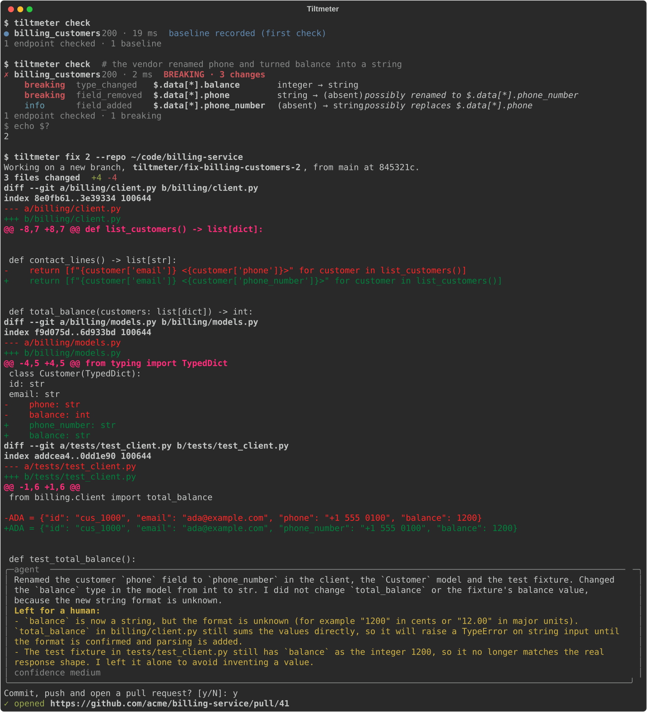

# Tiltmeter

[](https://pypi.org/project/tiltmeter/)
[](pyproject.toml)
[](LICENSE)

**An early-warning system for the third-party APIs your AI agents depend on, with the fix as a pull request.** · [tiltmeter.dev](https://tiltmeter.dev)

<!-- pypi-skip-image -->

<!-- /pypi-skip-image -->

Volcanologists bolt tiltmeters to the ground to sense tiny deformations long before an
eruption. Tiltmeter does the same for the APIs under your agents. It learns the shape of
their JSON responses from real traffic, notices when a vendor renames a field, starts
sending `null` or turns a number into a string, and tells you, your CI and the agents
themselves before anything goes on tilt. Then `tiltmeter fix` hands the change to an agent
that adapts the code reading that API and opens the pull request, leaving what it cannot
know for a human.

Typed code crashes loudly when an API changes. Agents don't. They read the new response,
fill the gaps with guesses, or retry until the budget is gone.

## Highlights

- **Agents can check before they act.** An MCP server lets Claude Code, Cursor, LangChain
  or any MCP client call `has_drifted` before trusting an API, and `get_schema` to see
  which fields to expect.
- **No spec required.** Tiltmeter learns from real responses, so it works with any JSON
  API, documented or not.
- **Breaking or harmless, at a glance.** Every change is classified as breaking, warning
  or info, and a removed field next to a similar new one is flagged as a probable rename.
- **Explanations on demand.** With an Anthropic API key, Claude explains what changed,
  the likely cause and what to do about it.
- **Fixes, too.** `tiltmeter fix` hands the drift to a LangChain Deep Agent that adapts the
  code reading that API, shows you the diff and opens a pull request.
- **A CI gate with alerts.** Exit codes fail the build on breaking drift. Slack and
  webhook alerts take one line of config.
- **Local and private.** One SQLite file and no account. Credentials are expanded at
  request time and never stored. Response bodies are not stored or sent to the LLM, only
  their shape.

## Quickstart

```bash
pip install tiltmeter        # or: uv tool install tiltmeter
tiltmeter init               # writes tiltmeter.yaml with a public example API
tiltmeter check              # the first check records the baseline
```

Run `tiltmeter check` again from cron or CI, or leave `tiltmeter watch` running. This is
what you get when a vendor renames `phone` and turns `balance` into a string:

```console
$ tiltmeter check
✗ billing_customers  200 · 13 ms  BREAKING · 3 changes
    breaking  type_changed   $.data[*].balance       integer → string
    breaking  field_removed  $.data[*].phone         string → (absent)  possibly renamed to $.data[*].phone_number
    info      field_added    $.data[*].phone_number  (absent) → string  possibly replaces $.data[*].phone
1 endpoint checked · 1 breaking
$ echo $?
2
```

The [getting started guide](docs/getting-started.md) runs that exact scenario against a
fake API on your machine in about five minutes.

## Give your agents a tiltmeter

```bash
claude mcp add tiltmeter -- tiltmeter serve --config /absolute/path/to/tiltmeter.yaml
```

Then add a line like this to your agent's instructions:

> Before you rely on a third-party API, call `has_drifted` for it. If it drifted, read the
> summary and adapt before trusting the response.

| Tool | What it answers |
|---|---|
| `has_drifted(endpoint_id, since?)` | Did the responses change at warning level or worse recently? Returns a summary and the changes. |
| `get_schema(endpoint_id)` | Which fields, types and enum values to expect, as JSON Schema. |
| `get_changes(endpoint_id?, since?, min_severity?, limit?)` | The change history, newest first. |
| `list_endpoints()` | Which APIs are watched and how their last check went. |
| `check_api(endpoint_id, explain?)` | Calls one API now and records the result. |
| `check_all(explain?)` | Calls every API now. |

Setups for Cursor, Claude Desktop and LangChain agents are in the
[agents guide](docs/agents.md).

## Let it fix your code

When a check finds drift, `tiltmeter fix` hands it to an agent that finds the code reading
that API, adapts it, shows you the diff and opens a pull request:

```console
$ pip install "tiltmeter[fix]"
$ tiltmeter fix 2 --repo ~/code/billing-service
✗ billing_customer  #2  200 · 10 ms  BREAKING · 3 changes
Working on a new branch, tiltmeter/fix-billing-customer-2, from main at 162dadd.
3 files changed  +5 -5
diff --git a/billing/client.py b/billing/client.py
-    return f"{customer['name']} <{customer['phone']}>"
+    return f"{customer['name']} <{customer['phone_number']}>"
...
Commit, push and open a pull request? [y/N]: y
✓ opened https://github.com/acme/billing-service/pull/41
```

- **Your checkout is never touched.** The agent works in a temporary git worktree on a new
  branch, and nothing is committed until you approve the diff or pass `--yes`.
- **It can only edit files.** No shell, no network access, no subagents. Only tracked files
  are there to read, and `.env` files, keys and `.git` are blocked.
- **It says what it could not do.** Tiltmeter sees types, not values. When a number turns
  into a string, the agent updates the types and leaves the format question to a human in
  the pull request instead of guessing a conversion.

`--dry-run` shows the diff and throws it away, and `--no-pr` commits to a local branch. The
[fix guide](docs/fix.md) covers the flags, what the model sees and how to review the result.

## What counts as drift

| Change | Example | Default severity |
|---|---|---|
| `field_removed` | `phone` was in every response and is gone | breaking |
| `field_now_optional` | `email` was always there and is now missing from some objects | breaking |
| `type_changed` | `balance` went from integer to string | breaking |
| `nullable_introduced` | `phone` can now be `null` | breaking |
| `content_type_changed` | the JSON body became an HTML error page | breaking |
| `status_changed` | 200 to 503 is breaking, 404 to 200 is info, 200 to 202 is a warning | depends |
| `enum_value_added` | `status` returned `suspended` besides `active` and `past_due` | warning |
| `latency_regression` | median latency over 3x the baseline and at least 250 ms slower | warning |
| `field_added` | a new `phone_number` field | info, or warning with `strict: true` |

Override any of them globally or per endpoint with `severity_overrides`.

## Use it in CI

| Exit code | Meaning |
|---|---|
| 0 | No drift. Info-only changes and new baselines count as no drift. |
| 1 | Warning-level drift. |
| 2 | Breaking drift. |
| 3 | A check could not run (network error, unexpected status, invalid JSON) and nothing broke. |
| 4 | Usage or configuration error. |

On GitHub, the [Tiltmeter Action](https://github.com/tiltmeter-dev/tiltmeter-action) keeps
the baseline in the Actions cache, writes the changes to the job summary and fails the job
on drift:

```yaml
- uses: tiltmeter-dev/tiltmeter-action@v1
  env:
    STRIPE_API_KEY: ${{ secrets.STRIPE_API_KEY }}
```

Anywhere else, keep `.tiltmeter/` between runs. The [CI guide](docs/ci.md) has
ready-to-copy jobs for GitHub Actions, GitLab CI and cron.

## How it works

1. **Observe.** A check calls the endpoint and turns the JSON body into a *shape*: for
   every path, which JSON types appeared, how many objects contained each field and, for
   fields that look categorical (`active`, `past_due`, `USD`), which values were seen.
2. **Compare.** The baseline is the merge of the shapes from the last 20 successful
   checks. Tiltmeter reports only what *contradicts* it: a missing optional field is
   fine, a field that was in every object and is now gone is not.
3. **Report once.** The new shape joins the baseline, so the check that sees a change
   reports it, and from then on it is the new normal.

<!-- pypi-skip-diagram -->

<!-- /pypi-skip-diagram -->

The pipeline is a small [LangGraph](https://github.com/langchain-ai/langgraph) graph that
only sequences the steps. The diff itself is plain, deterministic Python with no LLM in the
loop. [How it works](docs/how-it-works.md) covers the details.

## Configuration

```yaml
endpoints:
  - id: stripe_customers
    url: https://api.stripe.com/v1/customers
    params:
      limit: 10
    headers:
      Authorization: Bearer ${STRIPE_API_KEY}   # expanded from the environment at request time
    ignore_paths:
      - $.data[*].metadata                      # free-form, changes all the time

notify:
  - type: slack
    webhook_url: ${SLACK_WEBHOOK_URL}
```

Every option is described in the [configuration reference](docs/configuration.md), and
[`examples/`](examples) has a config you can run as is.

## How it compares

- **OpenAPI diff tools** such as oasdiff compare two versions of a spec. They are the right
  tool when the vendor publishes and maintains one, and they cannot see changes the vendor
  did not document.
- **Contract testing** such as Pact needs the provider to run your contracts, which
  third-party vendors don't do.
- **Uptime and synthetic monitors** tell you an API is up. You write and maintain the
  response assertions yourself.
- **Tiltmeter** learns the contract from real responses, so it needs nothing from the
  vendor and catches undocumented changes. It also hands what it learns to your agents.

## Privacy and security

- `${VAR}` placeholders are expanded right before a request or notification is sent. The
  values are never written to disk, sent to the LLM or kept in the LangGraph state, and
  they are scrubbed from error messages.
- The history stores shapes, status codes, latencies and changes, never response bodies
  unless you set `store_samples: true`.
- Agents can only check the endpoints in your config. They cannot make Tiltmeter call an
  arbitrary URL.
- `tiltmeter fix` sends the change list and the files the agent opens to Anthropic. It
  never sees response values, `${VAR}` values or untracked files such as `.env`, and paths
  matching `fix.ignore` are blocked.

[SECURITY.md](SECURITY.md) has the full threat model and how to report a vulnerability.

## Roadmap

- **Fixes in CI and over MCP.** Run `tiltmeter fix` from the GitHub Action when a scheduled
  check finds drift, and let agents request a fix through an MCP tool.
- **Provider mode.** API vendors announce a change once and every customer gets the pull
  request.
- **Spec and changelog awareness.** Diff vendor OpenAPI specs and changelogs next to
  observed responses.
- **Hosted checks** and a team dashboard.

## Documentation

- [Getting started](docs/getting-started.md): a five-minute tour on your machine.
- [Configuration reference](docs/configuration.md): every option, placeholders and ignore patterns.
- [Agents and MCP](docs/agents.md): Claude Code, Cursor, Claude Desktop and LangChain.
- [CI and scheduling](docs/ci.md): GitHub Actions, GitLab CI and cron.
- [Fixing code](docs/fix.md): `tiltmeter fix`, the agent and how to review its pull requests.
- [How it works](docs/how-it-works.md): shapes, baselines, the diff rules and the pipeline.
- [FAQ and troubleshooting](docs/faq.md).

## Contributing

Bug reports, ideas and pull requests are welcome. [CONTRIBUTING.md](CONTRIBUTING.md)
explains how to set up the project and what a good change looks like. Everyone taking
part is expected to follow the [code of conduct](CODE_OF_CONDUCT.md).

## License

[MIT](LICENSE)
