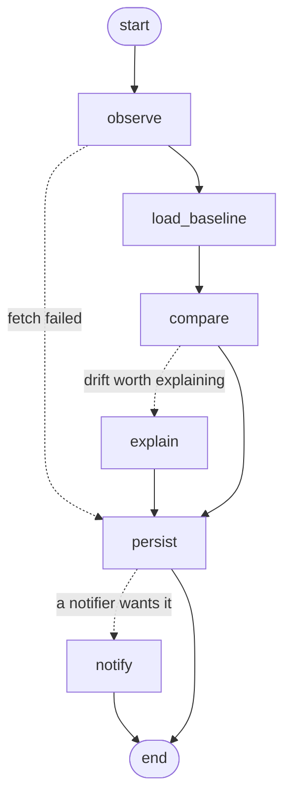

# How it works

Tiltmeter answers one question for every API you watch: *do the latest responses contradict
what this API has been returning?* This page explains how it builds that picture, which
differences it reports, and how the pieces fit together.

- [Observations and shapes](#observations-and-shapes)
- [The baseline](#the-baseline)
- [What gets reported](#what-gets-reported)
- [Status, content type and latency](#status-content-type-and-latency)
- [Outcomes and errors](#outcomes-and-errors)
- [Report once](#report-once)
- [The pipeline](#the-pipeline)
- [Storage](#storage)
- [Explanations](#explanations)
- [Privacy by design](#privacy-by-design)
- [Limitations](#limitations)

## Observations and shapes

A check sends the configured request `sample_size` times and parses each JSON body into a
**shape**: a tree with one node per location in the body. Each node records:

- how many values were seen there, and how many of each JSON type (`object`, `array`,
  `string`, `integer`, `number`, `boolean`, `null`);
- for objects, a child node per property. A property's count is the number of objects that
  contained it, which is how Tiltmeter tells required fields from optional ones;
- for arrays, one merged node for all their items;
- for strings that look **categorical**, the values seen and how often.

A string looks categorical when it is at most 32 characters of lowercase words joined by
`_`, `.` or `-` (`past_due`, `in-progress`, `v1.2`), or of UPPER_SNAKE_CASE (`USD`,
`IN_REVIEW`). The first value that doesn't fit, such as a name, an email, a URL, a
timestamp or a mixed-case id, switches value tracking off for that field, and so does a
33rd distinct value. That keeps personal data out of the history and keeps free text from
being mistaken for an enum.

Two limits keep huge or deep responses cheap: only the first 500 items of each array are
read, and nesting stops being explored after 32 levels.

## The baseline

The baseline of an endpoint is not stored. It is rebuilt before every check by adding up the
shapes of its last `baseline_window` successful checks, 20 by default. Because shapes are
counters, merging is just addition, and old observations age out as new checks arrive.

From the merged shape:

- a property is **required** when it appeared in every object observed at its location, and
  **optional** otherwise;
- a field is an **enum** when it holds 2 to 16 distinct categorical values and they repeat:
  at least 10 occurrences, and at least 3 per distinct value on average.

The baseline also remembers the last HTTP status the endpoint answered with, the media
type of its last JSON response, and the median latency of the window.

## What gets reported

The comparison walks the latest observation and the baseline side by side and reports only
what the observation **contradicts**. Seeing less than before is never a change: a
missing optional field, or no `null` this time for a field that is sometimes `null`, is
normal variation. Seeing something the baseline never saw is.

| Kind | Reported when | Default |
|---|---|---|
| `field_removed` | A required property is absent from every observed object. | breaking |
| `field_now_optional` | A required property is absent from some observed objects. | breaking |
| `type_changed` | A location holds a type the baseline never saw there. An integer where the baseline has numbers is fine; a float where it only has integers is not. | breaking |
| `nullable_introduced` | A location holds `null` for the first time. | breaking |
| `enum_value_added` | An enum field returns a value it never returned. Values that don't look categorical are reported without being shown. | warning |
| `field_added` | A property appears that the baseline never saw. Its subtree is reported once, as a whole. | info |

When a removed field and an added field share the same parent object and the same
non-null type, Tiltmeter marks them as a **probable rename**. It pairs them when their
names are similar (one contains the other once case, `_` and `-` are ignored, or they are
at least 70% alike), or when they are the only candidates under that parent. The hint is
evidence for a human or an LLM to weigh; the two changes are still reported separately.

`ignore_paths` removes whole subtrees from the walk. See the
[configuration reference](configuration.md#paths-and-ignore-patterns).

## Status, content type and latency

Three checks look at the response as a whole:

- **`status_changed`** when the status differs from the last status the endpoint answered
  with. Going from 2xx to anything else is breaking, coming back to 2xx is info, and any
  other move is a warning. When the status is not 2xx, the body is not compared.
- **`content_type_changed`** when a 2xx response stops being valid JSON after the endpoint
  used to return JSON, such as a login page or an HTML error.
- **`latency_regression`** when the median latency of the check is more than
  `latency_factor` times the baseline median and at least 250 ms slower, provided the
  baseline has three or more latency measurements.

## Outcomes and errors

Every check ends with one outcome:

| Outcome | Meaning |
|---|---|
| `baseline` | First successful check of the endpoint: the shape is recorded, nothing is compared. |
| `clean` | Nothing contradicts the baseline. |
| `changed` | Only info-level changes, such as a new field. |
| `drift` | At least one change at warning level or worse. |
| `error` | The API could not be verified. |

A check is an `error` when the request fails for good after its retries, when a
`${VAR}` placeholder has no value, when the response is larger than `max_body_bytes`,
when the status is not 2xx and no status change explains it, or when the very first 2xx
response is not JSON. Errors are recorded in the history like any other check. They
never change the learned shape; only their HTTP status, when there is one, becomes the
status the next check compares against.

## Report once

The shape of every successful check joins the baseline window, including the check that
found drift. So the next check compares against a baseline that already contains the new
shape, and the change is not reported again. A field renamed today shows up in today's
check, and tomorrow both names are simply optional fields in the baseline, until the old
one ages out of the window.

That makes Tiltmeter a changelog of what your vendors did, not a stuck alarm. In CI, it
means you must keep the `.tiltmeter/` folder between runs, as the [CI guide](ci.md)
shows, or every run starts from an empty baseline.

## The pipeline

Each check is one run of a small [LangGraph](https://github.com/langchain-ai/langgraph)
`StateGraph`:

| Node | What it does |
|---|---|
| `observe` | Expands placeholders, sends the requests and builds the observed shape. |
| `load_baseline` | Rebuilds the baseline from the history. |
| `compare` | Runs the deterministic diff and the severity rules. |
| `explain` | Asks Claude to explain the drift. Runs only when explanations are on, an API key is set and the worst change reaches `llm.min_severity`. |
| `persist` | Saves the check, its changes and its shape, then applies retention. |
| `notify` | Sends the result to every notifier whose threshold it meets, in parallel. |

LangGraph only sequences these steps and routes between them. Everything that decides
what counts as drift lives in `tiltmeter.core`, which is plain Python with no LangChain
imports and is type-checked with `mypy --strict`. Dependencies such as the store, the
HTTP client and the explainer reach the nodes through LangGraph's runtime context, so the
graph state only carries data. Endpoints are checked concurrently, up to `concurrency` at
a time, one graph run each. There is no checkpointer, because a run takes seconds and is
recorded in the history anyway.

With `LANGSMITH_TRACING=true` and a `LANGSMITH_API_KEY`, each run appears in LangSmith as
`tiltmeter check <endpoint>`, with the explanation call nested inside.

## Storage

The history is one SQLite file, `.tiltmeter/tiltmeter.db`, in WAL mode so the MCP server
can read while a scheduled check writes. It holds three tables:

| Table | Rows |
|---|---|
| `shapes` | Observed shapes, stored once per distinct content and keyed by the SHA-256 of their canonical JSON. An API that keeps returning the same structure costs one row. |
| `checks` | One row per check: time, status, media type, latency, outcome details, notes, explanation and a reference to its shape. |
| `changes` | One row per reported change, linked to its check. |

After each check, Tiltmeter keeps the newest `keep_checks` checks of that endpoint, never
fewer than its `baseline_window`, and deletes shapes nothing refers to anymore.

## Explanations

When the `explain` node runs, Claude receives:

- the endpoint id, method, description and URL without its query string;
- the detected changes, up to 60;
- for up to 8 affected objects, their field names and types before and after;
- the first 4,000 characters of the latest response, only with `llm.include_samples: true`,
  wrapped in tags and labelled as untrusted third-party data.

The call goes through LangChain's `ChatAnthropic` with structured outputs, so the reply
always parses into `summary`, `likely_cause`, `impact`, `suggested_action`,
`probable_renames` and `confidence`. The default model is `claude-haiku-5-5` at low effort,
because explanations only run when drift is found. A refusal, a truncated reply or an API
error becomes a note on the check, never a failed check.

## Fixing

`tiltmeter fix <check-id>` turns a check into a pull request. It is separate from the
check pipeline and only runs when you ask:

1. The check's removed, renamed, retyped, optional and nullable fields become *targets*.
   Renames come from the diff's hint, or from Claude's `probable_renames` when the diff had
   none.
2. A new branch is checked out from HEAD as a git worktree in a temporary folder, so the
   user's checkout is never touched.
3. A [LangChain Deep Agent](https://github.com/langchain-ai/deepagents) works in that
   worktree with file tools only (list, read, glob, grep, edit, write). The shell,
   subagent and delete tools are removed, and `.git` plus the `fix.ignore` paths are denied.
   Files the harness writes for itself, such as offloaded tool results, go to memory
   instead of the worktree. With `fix.agent: claude-code`, `claude -p` does the same job
   instead: `--restricted` with only the Read, Edit, Write, Glob and Grep tools, deny rules
   for `.git` and `fix.ignore`, and no MCP servers, hooks or user settings. Either way the
   agent ends with a structured report: summary, files changed, what is left for a human,
   and confidence.
4. Tiltmeter stages the edits, refuses any diff that touches an ignored path, and shows
   the diff. On approval it commits, pushes and opens the pull request with `gh`.

The [fix guide](fix.md) has the flags and the review checklist.

## Privacy by design

- **Secrets** are expanded only inside the request code, then scrubbed from error messages
  and excerpts. Config objects, the graph state, prompts and traces only ever see the
  `${VAR}` placeholders.
- **Response bodies** are reduced to shapes as soon as they arrive. The only values kept
  are short categorical strings such as `active`, unless you turn on `store_samples` or
  `llm.include_samples`.
- **Agents** can only check endpoints declared in the config. The MCP tools take an
  endpoint id, never a URL.
- **Fixes** send the change list and the files the agent reads to Anthropic, never response
  values or `${VAR}` values. The agent works in a fresh worktree, which holds no untracked
  files such as `.env`, and the `fix.ignore` paths are denied to its file tools.

## Limitations

- JSON over HTTP only. XML, CSV, binary and streaming responses are not supported.
- Tiltmeter sees what the API returns for the requests you declare. It does not read the
  vendor's OpenAPI spec or changelog.
- It watches responses, not requests: it cannot tell you that a parameter became
  mandatory, only what that did to the response.
- A field that is already optional in the baseline can disappear without an alert.
- Enum detection is a heuristic. It needs repeated categorical values, so a field that
  returns a single value will not alert when a second one appears for the first time.
- Only the first 500 items of each array and the first 32 levels of nesting are
  examined.
- `tiltmeter fix` works from types, not values, so it leaves format and unit questions to
  a human. It finds code by name and does not run your tests.
