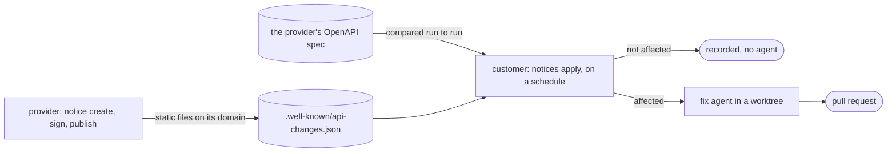

# Provider notices

`tiltmeter check` finds out that an API changed by watching its responses. Provider notices
work from the other end: the API's provider announces the change once, before it ships,
and every customer that follows the provider gets a pull request that adapts its code. No
server is involved. The provider publishes two static files on its own domain, and each
customer's scheduled job reads them. When a provider publishes no notices, a customer can
follow its OpenAPI spec instead, and Tiltmeter finds the changes itself.



- [For API providers](#for-api-providers)
- [For API customers](#for-api-customers)
- [Following a spec instead](#following-a-spec-instead)
- [Is my repository affected?](#is-my-repository-affected)
- [Trust and safety](#trust-and-safety)
- [Exit codes](#exit-codes)

The format itself is an open specification: [API change notices, version 1](notice-spec.md).

## For API providers

You need Tiltmeter (`pip install tiltmeter`), a place to serve two static files on your
domain (your docs site, GitHub Pages, a bucket behind your CDN), and either a check of
your own API that saw the change or the old and new versions of your OpenAPI spec. On
GitHub, [CI can do all of it](#or-let-ci-do-it) on every pull request.

### 1. Create a signing key, once

```console
$ tiltmeter notice keygen ~/secrets/api-change-key.pem --public site/.well-known/api-change-key
✓ wrote the private key to ~/secrets/api-change-key.pem (readable by you only)
✓ added the public key to site/.well-known/api-change-key:
  v=ACN1; k=ed25519; p=aBZQjpciUKQWg1MVODT9tlxFlEBTN2u3MsW+nfgQWm4=
```

Serve `site/.well-known/api-change-key` at `https://<your domain>/.well-known/api-change-key`
and keep the private key out of git, as you would a deploy key. A key from
`openssl genpkey -algorithm ed25519` works too. To rotate, run `keygen` with a new private
key path: it adds the new public key to the same file, and you remove the old line once
nothing you publish is signed with it.

### 2. Draft the notice

From two versions of your spec (OpenAPI 3.0, 3.1 or Swagger 2.0, YAML or JSON):

```console
$ tiltmeter notice create --from-openapi openapi-v2.yaml openapi-v3.yaml \
    --effective 2026-12-01 --sdk pypi:partner-sdk@3.0.0 -o notice.json
✓ drafted notice 2026-11-03-customers with 5 changes
```

Each operation's success response goes through the same diff Tiltmeter uses for drift,
so renamed fields are paired, and removed, retyped, newly optional and newly nullable
fields and new enum values are found. New fields are left out. An operation that is gone
becomes an `endpoint_removed` change. When one new operation looks like where it went
(the same method, a path one segment away, such as `/playlists/{id}/tracks` and
`/playlists/{id}/items`, and a response alike enough), the change says so in `moved_to`,
and the operation's other changes compare the old response with the new one's. Check
that guess before you sign. Retired values, such as a model id requests may no longer
send, are not in a spec: add a `value_retired` change by hand. Each named schema is
compared once and reported at the shortest path that reaches it, so specs with thousands
of schemas and "id or expanded object" fields (Stripe's) take about a second. Only local
`$ref`s are followed, so bundle a multi-file spec first: a reference to another file, or
to a schema the spec does not define, is not compared, and a note says how many there
were.

Or from a check of your own API, for example against staging:

```console
$ tiltmeter notice create --from-check 26 --url https://api.partner.example/v1/customers -o notice.json
```

`--url` is the URL your customers call, when the check ran against another host.

The draft is yours to edit before you sign it: rewrite `summary`, and add a `note` to a
change wherever the new format matters ("Decimal string in the account currency, such as
`12.00`"). The [spec](notice-spec.md) lists every member.

| Option | Description |
|---|---|
| `--from-openapi OLD NEW` | The old and the new spec. |
| `--from-check ID` | A stored check that found the change. |
| `--url URL` | With `--from-check`: the public URL of the endpoint. |
| `--base-url URL` | With `--from-openapi`: what the paths start from, when the spec's first server is relative or templated. |
| `--provider DOMAIN` | Your domain. Defaults to the endpoints' host. |
| `--id ID` | Defaults to `<date>-<resource>`, such as `2026-11-03-customers`. |
| `--summary TEXT` | Defaults to a plain sentence per set of changes. |
| `--effective DATE` | When the old responses stop: `2026-12-01` or an ISO 8601 time. |
| `--sdk ECOSYSTEM:NAME@VERSION` | An SDK release that already follows the change. Repeatable. |
| `--if-changed` | With `--from-openapi`: when no response changed, write nothing and exit 0. |
| `-o`, `--output FILE` | Where to write it; stdout otherwise. `--force` overwrites. |

### 3. Sign and publish

```console
$ tiltmeter notice sign notice.json --key ~/secrets/api-change-key.pem
$ tiltmeter notice publish notice.json --feed site/.well-known/api-changes.json
✓ published 2026-11-03-customers
site/.well-known/api-changes.json holds 1 notice (signatures checked against site/.well-known/api-change-key).
```

Both take several notices. The key can also come from `TILTMETER_SIGNING_KEY`, either a
path or the PEM itself, as a CI secret holds it; it is never printed. `publish` adds the
notices to the feed (replacing older copies with the same id, newest first) and, when the
key file sits next to the feed, checks every signature against it. With `--key`, it signs
the notices on the way in, so the files themselves can stay unsigned drafts, and
`--replace` builds the feed from the given notices only. Deploy the folder, and check what
customers will see:

```console
$ tiltmeter notice verify https://api.partner.example/notices/2026-11-03-customers.json
```

`verify` takes a file too, and `--key-file` checks it against a local key file before you
deploy.

### Or let CI do it

The [Tiltmeter Action](https://github.com/tiltmeter-dev/tiltmeter-action) has two modes for
providers. [`examples/provider-notices.yml`](../examples/provider-notices.yml) wires them to
GitHub Pages:

- **`mode: notice-draft`**, on pull requests that touch your spec: it compares the spec with
  the base branch and keeps one comment on the pull request with the changes and a draft
  notice. Save the draft in `notices/`, edit its summary and notes, and merge. With
  `require-notice: true`, a pull request that changes responses without a notice fails.
- **`mode: notice-publish`**, on the main branch: it signs every notice in `notices/` with
  the `TILTMETER_SIGNING_KEY` secret into `site/.well-known/api-changes.json`, checked
  against the `api-change-key` you commit there, ready for Pages or any static host.

The notices in the repository stay unsigned and reviewable like code; the signed feed is
built on every deploy, and Ed25519 signatures come out the same every time.

## For API customers

### Subscribe

List the providers you follow in `tiltmeter.yaml`. Endpoints are optional when you only
follow notices:

```yaml
subscriptions:
  - provider: api.partner.example                          # reads https://api.partner.example/.well-known/api-changes.json
  - feed: https://status.other.example/api-changes.json     # any https feed
  - provider: payments.example                             # a feed elsewhere, but only this provider's notices
    feed: https://changes.example.org/payments.json
    since: 2026-11-01                                       # skip notices published before this date
  - openapi: https://raw.githubusercontent.com/acme/api/main/openapi.json   # no notices: follow the spec
```

The first run of a feed brings news, not its whole history: without `since`, a notice
published more than 30 days before you subscribed, and already in effect then, is
skipped. Notices whose change is still ahead are kept, however old. For the changes that
shipped before, run [`tiltmeter scan`](scan.md): it searches your code for every entry of
a catalog of known changes, whatever their dates.

### See what is new

```console
$ tiltmeter notices check --repo .
api.partner.example  https://api.partner.example/.well-known/api-changes.json
  ● api.partner.example  2026-11-03-customers  signed · published 2026-11-03 · effective 2026-12-01
      Customers now return phone_number instead of phone, and balance as a decimal string.
      affects this repository: the repository mentions api.partner.example and /v1/customers, and code near them reads phone and balance
      billing/client.py, billing/models.py
  1 new
```

`check` downloads the feeds and specs, verifies every signature and lists what is new. It
records nothing and runs no agent. Without `--repo` it does not search your code. `--all`
also lists notices handled before.

### Apply them

```console
$ tiltmeter notices apply --repo . --yes
```

For each new notice or spec change, oldest first:

1. A plain text search decides whether the repository uses what the notice changes
   ([below](#is-my-repository-affected)). When it does not, the notice is recorded as not
   affected and no agent runs.
2. When the fix branch, `tiltmeter/fix-<provider>-<id>-<digest>`, is already on the remote,
   no agent runs either: Tiltmeter finds its pull request, or opens it from the branch's
   commit when an earlier run could not.
3. Otherwise the [fix agent](fix.md) adapts the code in a fresh worktree, starting from the
   files and endpoints the search found, and Tiltmeter opens the pull request. The title
   carries the date the change takes effect, and the body quotes the provider and lists
   what is left for a human.

Each notice is handled once; the outcome is kept in `.tiltmeter/`. A fix that failed, was
committed but not pushed, or was pushed without its pull request is tried again on the
next run, up to three times. Without `--yes`, you are asked before each commit;
`--dry-run` shows the edits and records nothing; `--no-pr`, `--base`, `--allow-unused` and
`--agent` work as for [`tiltmeter fix`](fix.md#flags). A fix whose edits are all in old code
that nothing uses stays in a local commit and is recorded as committed, so it is not tried
again ([why](fix.md#code-nothing-uses)).

On GitHub, the [Tiltmeter Action](ci.md#provider-notices) runs `notices apply` on a
schedule, with the state in the Actions cache: a workflow of about 20 lines and no service
of ours.

### One notice, by hand

```console
$ tiltmeter fix --notice https://api.partner.example/notices/2026-11-03-customers.json --repo .
$ tiltmeter fix --notice draft.json --allow-unsigned --repo . --dry-run
$ tiltmeter fix --notice groq-retired-models-2026-08 --allow-unsigned --repo .
```

`--notice` takes a file, an https URL, `FEED#ID` for one entry of a feed file or URL, or the
id of an entry in the catalog [`tiltmeter scan`](scan.md) reads. A notice from a URL must
be signed. An unsigned one is accepted only from a file or the catalog, and only with
`--allow-unsigned`: use it for notices you wrote, got from someone you trust, or that
Tiltmeter drafted.
`fix --notice` runs the agent even when the text search finds nothing, and records the
outcome when there is a `tiltmeter.yaml` and the notice is signed.

## Following a spec instead

Most providers don't publish notices yet, but many publish an OpenAPI spec. Follow it, and
Tiltmeter does the provider's part:

```yaml
subscriptions:
  - openapi: https://raw.githubusercontent.com/acme/api/main/openapi.json
    provider: api.acme.example      # optional: defaults to the host of the spec's server
    base_url: https://api.acme.example   # when the spec's first server is relative or templated
    sdks: ["pypi:acme", "npm:@acme/sdk"] # their SDKs, so code that uses them counts too
    versioned: false                # true for APIs whose clients pin a version, like Stripe
    baseline: https://raw.githubusercontent.com/acme/api/v1.4.0/openapi.json  # optional
```

1. The first `notices apply` keeps the spec as a baseline (compressed, in `.tiltmeter/`).
   With `baseline`, the spec version your code was written against, it compares the
   latest version with that one first, so code that is already behind gets its pull
   request on the first run. A tag or commit URL works, and so does another file for
   providers that publish one per version, such as GitHub's
   `api.github.com.2022-11-28.json`.
2. Each later run compares the latest version with it, with the same diff as
   `notice create --from-openapi`. A change to descriptions or examples only moves the
   baseline on. A change to responses becomes an entry for the endpoints this repository
   uses, at most 50, picked by the paths in your code, by its SDK calls
   (`stripe.Subscription.retrieve(...)`), or otherwise by the changed field names it reads.
3. The entry is kept as it was found, with the baseline moved past it, and then goes
   through the same search, fix and pull request as a notice. A retry works on the same
   change even if the spec has moved on since.

The provider announced none of it, and the output says so: the pull request names the
spec, its versions and the dates they were fetched, calls renames "probable", and warns
that a spec can run ahead of production or lag behind it.

**Versioned APIs.** Some providers pin each client to an API version (Stripe's
`Stripe-Version`), so their public spec describes the latest version, which you adopt on
purpose. With `versioned: true`, a change that comes with a new `info.version` is applied
only when the repository already mentions the new version; otherwise it is recorded as not
affected, with the reason. Changes within the same version are applied as usual.

Specs are fetched uncompressed, up to `max_bytes` (32 MB by default). YAML aliases are
expanded up to one value per byte of the file (at least a million), so a file built to
expand exponentially is refused.

## Is my repository affected?

Before any agent runs, Tiltmeter reads the tracked files once and searches them, without
an LLM:

1. **Uses of the API.** The notice's hosts (`api.partner.example`), the literal start of
   each endpoint path (`/v1/customers`), its SDKs in your dependency manifests
   (`requirements*.txt`, `pyproject.toml`, `package.json`, `go.mod`, `pom.xml`, `Gemfile`,
   `Cargo.toml`, `composer.json`, `.csproj` and the like), and code that imports them
   (`import Stripe from "stripe"`, `import stripe`). A path without its version
   (`/customers`) counts only in a file that also names the host or imports the SDK, since
   apps have routes like `/account` of their own.
2. **The changed fields near those uses.** The old field names, also in camelCase and
   PascalCase (`phone_number`, `phoneNumber`, `PhoneNumber`), as whole words, in a file that
   uses the API or in any file under its folder. When code imports the SDK, nearness is
   measured from that code, not from the manifest at the root.

No use of the API, or uses without the fields near them, means not affected. Paths alone
are not enough, because another vendor's API can have a `/v1/customers` too: the host or
an SDK has to appear somewhere in the repository. Docs (`.md`, `.mdx`, `.rst`, `.txt`),
ignore files, lock files, change notices and feeds, `tiltmeter.yaml`, binaries, files over
1 MB, symbolic links and anything matching `fix.ignore` are never read.

Retired values, removed endpoints and changed fields count only in code, not in comment
lines (`#`, `//`, `/* */`, `--`) or Python docstrings. A retired value counts spelled whole:
`gpt-4` is not in `gpt-4o`, `gpt-4.1` or `gpt-4.txt`, and a short one made of letters and
digits, such as `o1`, counts only in quotes. A removed endpoint counts where code spells
its whole path with no host in front of it, or with a host on the provider's domain that
is not the one it moved to; through an SDK call, only in a file that names the API, and
only when the replacement does not look the same to the SDK. An endpoint that moved to the
same path on another host, as Hugging Face's `/v1/chat/completions` did, counts wherever
code still names the old host.

When it is affected, the agent gets the endpoints the repository uses, and the matching
files as starting points:

- first those whose path appears in code (`f"/v1/customers/{id}"` and
  `` `/repos/${owner}/${repo}` `` match their endpoints), or that code calls through an
  SDK in the usual `resource.verb(` form: `stripe.Subscription.retrieve(` is
  `GET /v1/subscriptions/{id}`, `client.messages.create(` is `POST /v1/messages` and
  `octokit.rest.pulls.list(` is `GET /repos/{owner}/{repo}/pulls`. A namespace in the path
  must be in the call too: `stripe.checkout.sessions.create(` is
  `POST /v1/checkout/sessions`, not `POST /v1/financial_connections/sessions`;
- then those whose path only starts with a path in code that names no endpoint, such as
  a `"/v1/customers"` base path;
- when nothing names an endpoint, those whose changed field names appear near the API's
  uses, rarer names weighing more.

The changes to fields the code reads come first, so they are the ones the agent and the
pull request show when there are too many to list (60 in the prompt and 100 in the pull
request, shared out between the endpoints).

## Trust and safety

- **Only signed notices act on their own.** A notice must be signed with a key served at
  `https://<provider>/.well-known/api-change-key`, and every endpoint in it must be on the
  provider's domain, so nobody can announce changes to someone else's API. Unsigned or
  tampered notices are listed as rejected and never applied. Spec changes are trusted
  because you chose the spec's URL, and they are labelled as such everywhere.
- **Provider text is data.** The summary and notes reach the agent marked as untrusted
  data, never as instructions, and reach the pull request inside a plain-text block, so
  they cannot add links, images or @-mentions. Control characters are rejected outright.
- **The same sandbox as every fix.** The agent works in a fresh worktree with the limits
  described in the [fix guide](fix.md#what-the-agent-can-and-cannot-do). Nothing is merged
  for you.
- **Bounded downloads.** Feeds, notices, keys and specs are fetched over `https` only,
  every redirect included, uncompressed, with size and time limits, and no credentials are
  ever sent.

## Exit codes

| Command | 0 | 1 | 3 | 4 |
|---|---|---|---|---|
| `notices check` | nothing new | new notices (that affect `--repo`, when given) | a feed or spec could not be read | usage or config error |
| [`scan`](scan.md) | nothing in the catalog affects the folder | the folder uses a change in the catalog | the catalog could not be read | usage error |
| `notices apply` | everything handled | an agent changed nothing but left questions, touched an ignored file, or only edited old code that nothing uses | a fix, a feed or a spec failed | usage or config error |
| `notice verify` | signed and verified | valid but unsigned | invalid, or the signature does not match | usage error |
